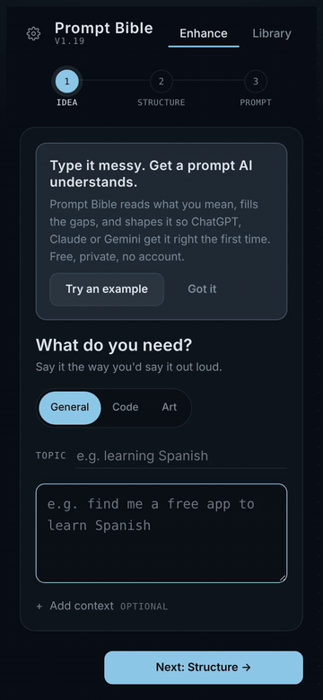
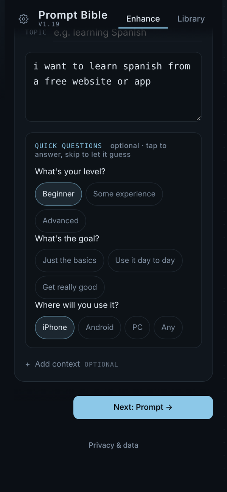
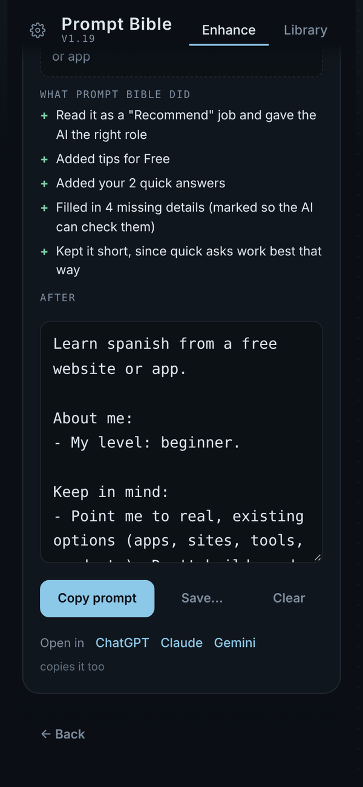
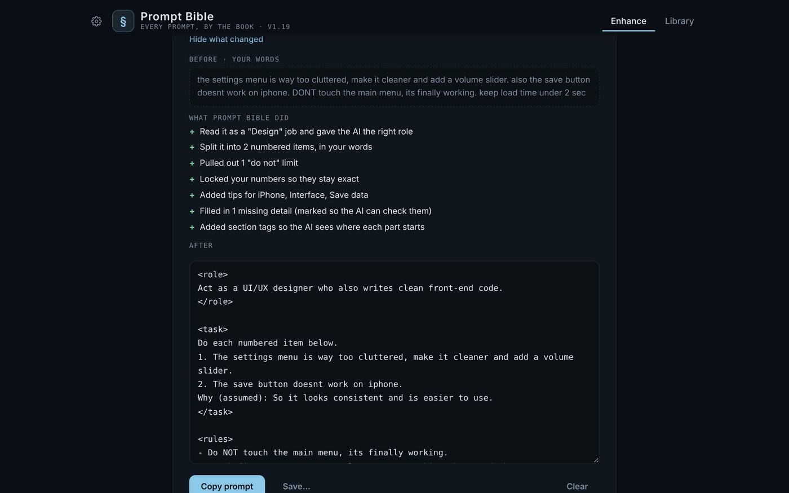
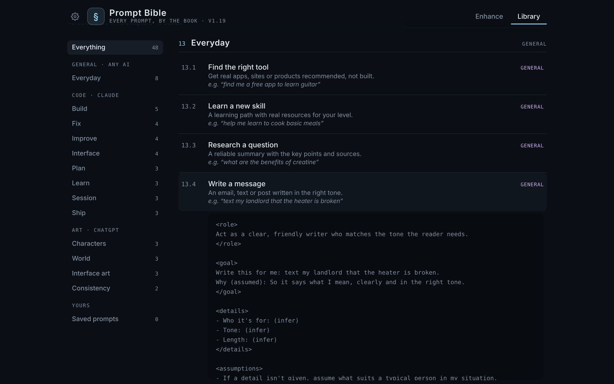

# Prompt Bible

**Type it messy. Get a prompt AI understands.**

Prompt Bible turns what you'd say out loud into a clear prompt that ChatGPT, Claude or Gemini get right the first time.
Free, private, no account, works offline.

### [Open Prompt Bible](https://mynamejeff625-png.github.io/prompt-bible/)

## Why it exists

You usually know exactly what you want. The AI doesn't. It fills the gaps with guesses, and you get something generic, or the wrong thing entirely.
(Ask an AI to *find* you a free app to learn Spanish and it may happily *build* you one.)

Prompt Bible fills those gaps before you hit send.

## How it works

1. **Say it the way you'd say it out loud.** Pick General, Code or Art.
2. **It works out what kind of job it is** (recommend, learn, write, decide, plan, fix, build and more) and asks up to 3 quick questions, only when something important is missing.
3. **You get the prompt**, with the right role, the details that matter, and anything it had to guess clearly marked so the AI checks with you. Tap **Show what changed** to see exactly what it did, then copy it or open it straight in ChatGPT, Claude or Gemini.

Simple questions stay simple: if your prompt is already clear, it tells you it's **good as is**.

| | |
|---|---|
|  |  |

**Long, messy requests get organized:** several asks become a numbered list in your own words, "don't touch this" limits are pulled out, what you stressed goes first, and your numbers stay exact.

**A library of 48 structures** for everyday questions, code and art, each with a real example.

## Install it like an app

- **iPhone:** open the link in Safari, tap Share, then **Add to Home Screen**.
- **PC:** open the link in Edge or Chrome and choose **Install** from the address bar (or the menu).

## Privacy

Everything you type and save stays in your browser, on your device. There's no account and no tracking.

Sharing is **off** unless you choose **Share anonymously**. If you do, only the idea you typed (with emails and phone numbers removed), the mode and structure, and your optional "Did it get your meaning?" answer are sent, to help train the engine. You can turn it off anytime under **Privacy & data** in the app.

## How it's built

One self-contained web page: no AI service, no API costs. The engine is plain rules plus a small learning model that runs in your browser.
This is an early demo, and it gets better as people tell it when it missed.

## Feedback

Tap **Not quite** after copying a prompt (with sharing on), or leave a comment wherever you found Prompt Bible.
